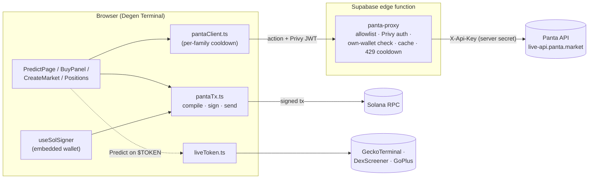

# Degen Terminal × Panta: prediction markets

This is the Panta prediction-market integration from [Degen Terminal](https://dgnterminal.com), pulled out on its own so it can be read and reviewed.

- **Live app:** https://dgnterminal.com (open the **Predict** tab)
- **Demo video:** _TODO: add demo video link_

> **The full app is closed source.** This repo contains only the Panta integration. Wallet internals, other chains, fee logic and admin code were removed and replaced with small typed stubs marked `// stub: lives in private Degen Terminal codebase`. **Judges can request access to the private repo.**

## What Degen Terminal is

Degen Terminal is a multi-chain trading terminal built for first-time traders in emerging markets. Trade crypto, tokenized US stocks and prediction markets across six chains from one app, with embedded wallets (no seed phrase), a safety check on every token, and an AI agent that finds tokens and flags scam risks before you buy. Live at dgnterminal.com with 212 users in open beta. The Panta integration adds a **Predict** tab: YES/NO prediction markets on Solana, paid in USDC. From any Solana token page there is also a one-click **"Predict on $TOKEN"** button that pre-fills a market from live on-chain data.

## How Panta is integrated

The integration rests on three rules:

1. **The Panta API key never reaches the browser.** Every call goes through `panta-proxy`, a Supabase edge function. It allows only listed actions, verifies the user's Privy session on writes, and replaces any `wallet` parameter with the caller's own stored Solana wallet. A user can never quote, build or claim for someone else's wallet.
2. **Panta builds transactions. We sign and broadcast them.** Panta returns unsigned instructions or a serialized transaction. The browser compiles them, signs with the user's embedded wallet and sends them over our own RPC. Then it reports the signature back to Panta.
3. **One API key is shared by every user**, so rate limits are shared too. Catalog reads are cached in the proxy. When Panta returns a 429, the proxy and the browser both pause that action family (`read`, `quote`, `build`, …) until the retry window passes.

### Market list → trade → position

| Step | UI | Proxy action → Panta route |
|---|---|---|
| Browse markets | `PredictPage` lists open (`primary`) markets with a category filter | `categories`, `markets` (cached 30 s), `market` (cached 15 s) |
| Quote | `BuyPanel`: pick YES/NO and a USDC amount, then press **Get quote**. Quotes are never polled. | `buyQuote` → `/primaryorderquote/` |
| Confirm | The user must tick "I can't sell before resolution" before the buy button unlocks | — |
| Build | Proxy returns unsigned instructions and a recent blockhash | `buyBuild` → `/primaryorderbuild/` (max slippage 100 bps) |
| Sign + send | `compileInstructions` builds a v0 transaction; `signAndSend` signs, broadcasts and confirms | (our RPC) |
| Register | Signature sent to Panta (best effort) | `buySubmit` → `/primaryordersubmit/`, `report` → `/trades/` |
| Position | `Positions` shows shares, estimated value (spot price × shares) and resolution state | `positions`, `market` (one call per market) |
| Claim | **Claim winnings** once a market resolves in the user's favour | `claimBuild` → `/claim/build/`, then sign + `report` |

**Creating a market** (`CreateMarket`) follows the same steps. The user writes a question, a resolution rule and source-of-truth links, then uploads an image through Panta's signed upload. `createQuote` returns the creation fee. The UI checks that `liquidityInjection + platformRevenue == payment` and blocks creation if the parts don't add up. Then come `createBuild` (a full serialized transaction), sign + send, and `createRegister`, retried while Panta indexes the transaction. Creators can later claim creator fees once the market graduates (`creatorFeesBuild`).

**"Predict on this token"** (`PredictShortcut` → `CreateMarket` with a prefill) reads a fresh snapshot of the token (`liveToken.ts`):

- circulating market cap from GeckoTerminal, never FDV
- volume and liquidity from DexScreener's deepest pool
- holder count from GoPlus

It then offers templates (market cap, pump.fun graduation, holders, volume, liquidity floor) whose thresholds and resolution rules come from those numbers. A template is hidden when its data source has nothing, so a threshold is never guessed.

**Safety:** Panta has no testnet, so every signed transaction moves real mainnet USDC. Dev and preview builds stop after building the transaction and never sign it (`PANTA_BROADCAST_ALLOWED`, with `PreviewLockBanner` in the UI). The "you can't sell this position" notice appears before the user enters any amount.

## Architecture



## File guide

```
src/
  api/
    config.ts          Feature flags, proxy URL (env), Panta URL, USDC mint, categories
    pantaClient.ts     panta(action, payload): the only browser → proxy call; errors → plain language
    pantaTx.ts         Compile Panta instructions to a v0 tx, sign, broadcast, confirm; USDC balance
    liveToken.ts       Fresh market-cap / volume / liquidity / holders snapshot for templates
  components/
    PredictPage.tsx    Predict tab: market list, market detail, tabs
    BuyPanel.tsx       Quote → acknowledge → build → sign → submit/report
    CreateMarket.tsx   Create form, live-data templates, image upload, fee check, register
    Positions.tsx      Positions, estimated value, claim winnings / creator fees
    PredictShortcut.tsx  "Predict on $TOKEN" deep link from Solana token pages
    shared.tsx         "Powered by Panta" attribution, no-exit notice, preview lock, formatters
  hooks/
    useSolSigner.tsx   Get a Solana signer (password unlock or embedded wallet), then run an action
  types/
    panta.ts           Market, position, quote, build and create response shapes
  stubs/               Typed stand-ins for private code (auth, signer, wallet, RPC, UI kit)
server/
  panta-proxy/
    index.ts           The edge function: action allowlist, auth, wallet binding, cache, cooldown
    _shared.ts         Stubs for the private CORS / Privy / database helpers
    AGENTS.md          Rules this integration must keep
.env.example           Variable names only. Real values are deployment secrets.
```

To typecheck: `npm install && npm run typecheck`. This repo is for reading and review, not running as-is. The stubs don't sign, authenticate or look up wallets. Deploy the proxy with `verify_jwt = false`, because it verifies Privy tokens itself.

## Links

- Degen Terminal: https://dgnterminal.com
- Panta: https://panta.market
- Demo video: https://www.youtube.com/watch?v=pc1K0PQ7Wk8
- Private repo access: available to judges on request x.com/dgnterminal
- t.me/legalalien0x
